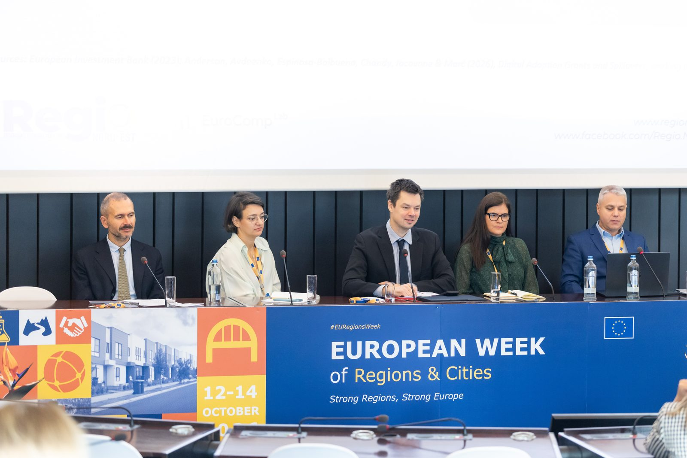
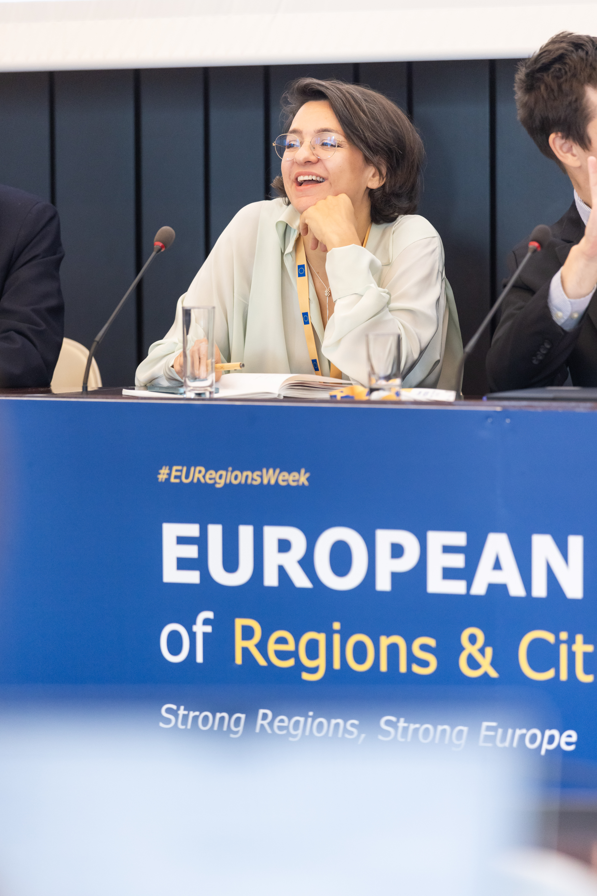
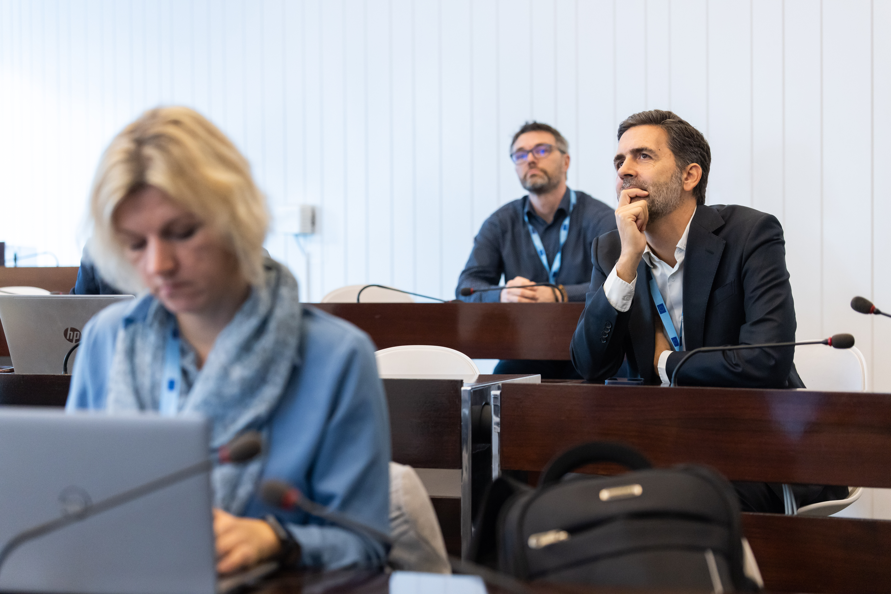

::: {.team-note}
## Summary {.unlisted}
The European Regional Competitiveness Policy Lab (EuroCOMP Lab) is a joint initiative of the European Commission's Directorate-General for Regional and Urban Policy (DG REGIO) and the World Bank Group. It embeds rigorous, randomised experimentation in European Union (EU) Member States' investments in competitiveness programmes under cohesion policy, so the EU can learn what works, for whom, and why.
:::

:::: {.cards .results .glance}
::: {.card-e}
[4 years]{.num}

**Programme length**

A partnership of DG REGIO and the World Bank Group.
:::
::: {.card-e}
[27]{.num}

**Member States invited**

With a focus on lagging countries and regions.
:::
::: {.card-e}
[13]{.num}

**Randomised controlled trials**

Policy lessons and insights across both phases.
:::
::: {.card-e}
[4]{.num}

**Workstreams**

From new evidence to measuring competition.
:::
::::

## See it in action

A short introduction to the EuroCOMP Lab, how impact evaluations can make public
support more efficient and effective, and how it is already being used to improve
programmes across Europe.

::: {.video-frame}

:::

## What the EuroCOMP Lab does {data-part="Part 1 of 3 · The Lab"}

DG REGIO and the World Bank are expanding their partnership on learning about the competitiveness agenda through the development of the EuroCOMP Lab. Its objective is to embed innovative experimental approaches in Member States' investments in competitiveness programmes, with a focus on regional impacts. This second round of investment in rigorous policy experimentation supports cohesion policy's competitiveness agenda, with a focus on new strategic and nimble innovations, as well as further institutional strengthening and cross-regional learning.

The EuroCOMP Lab finances three types of activities:

- new (nimble and strategic) randomised controlled trials (RCTs) in competitiveness programmes across Europe
- improved mechanisms and platforms for learning between networks of researchers, policymakers, and implementers in the EU
- knowledge generation about what works in the medium to long term, including through the use of administrative data

By embedding innovative experimental approaches in Member States' investments in competitiveness programmes, the project supports institutional strengthening and cross-regional learning, which will be critical for future competitiveness operations in Europe. The work generates innovative and rigorous policy experiments in areas such as green and digital transformation, setting the framework for future coordination and improvement of the policy mix in competitiveness programmes and interventions over time.

The studies designed in this project also contribute to a larger, global body of evidence on how to foster competitive markets, address market failures such as information asymmetries and behavioural biases, and adequately support and target private sector investment. The knowledge gained is intended for use in other regions too, enabling the World Bank to apply findings and lessons learned to enhance the effectiveness and impact of its operations globally.

## Building on earlier work

An important first step towards embedding experimentation within cohesion policy funds was made through the cooperation between DG REGIO and the World Bank.

An open call for interested managing authorities in EU Member States working on the competitiveness agenda drew a strong response. The Strengthening of Monitoring and Evaluation of EU Innovation Programmes project, informally known as 'Smart M&E', then provided technical assistance for designing and setting up five innovative policy experiments in four Member States. This was possible thanks to considerable investment in building local and institutional capacities.

DG REGIO also supported policy experimentation on mechanisms to increase digitalisation among small and medium-sized enterprises (SMEs) in three further Member States, under the 'Digitrans' project. Together, these projects initiated an ambitious, strategic agenda that is helping managing authorities learn through policy experiments about the impact of competitiveness programmes.

The [Examples](03-examples.qmd) page describes several of these experiments.

## How it works

The programme runs for four years. All EU Member States are invited to take part, with a focus on lagging countries and regions.

Work with Member States includes technical assistance for better programming: reviewing theories of change, bringing good global practices to the EU, and supporting the design of outreach, targeting, and actionable, informative monitoring systems. The project works closely with external researchers, with a clear emphasis on capacity building, leveraging the existing evaluation network developed by DG REGIO, and offering on-demand support to regional authorities on introducing experimental learning into policymaking.

The World Bank focuses on analytical and advisory work, while implementation remains the responsibility of Member States. Wherever possible, impacts are assessed at sub-regional level, for example comparing capital cities with other regions, reflecting a clear mandate of DG REGIO's focus under cohesion policy.

## The programme's four workstreams

The project follows a programmatic approach, given the complexity of the task and the need to sequence support to Member States. The work is organised into four workstreams. Across both phases, the first three will generate policy lessons and insights from 13 RCTs:

- **Workstream 1** generates new rigorous evidence on how to design cohesion policy programmes more effectively and efficiently.
- **Workstream 2** fosters new connections and improved mechanisms and platforms for learning between networks of researchers, policymakers, and implementers in the EU.
- **Workstream 3** follows up on the medium- to long-term impacts of ongoing RCTs under the Smart M&E and Digitrans projects.
- **Workstream 4** aims to enhance the understanding and measurement of competition levels, providing insights to support evidence-based decision-making. By identifying key influencing factors and analysing barriers to market competition, it focuses on the case study of EU public procurement.

## The EU must become more competitive {data-part="Part 2 of 3 · Why it matters"}

To achieve greater productivity and to address a growing competitiveness gap with other leading economies, Europe must undergo a radical transformation. This gap, particularly compared with the United States and China, has been increasingly evident. In 2021, for instance, EU companies spent about half as much on Research and Innovation (R&I) as a share of Gross Domestic Product (GDP) as US companies. Increased funding alone will not close this gap.

For the past two decades, the EU's top three investors in R&I have consistently been automotive companies, which mirrors the early 2000s in the US. While top investors in the US have recently shifted to the tech sector, EU companies continue to cite regulatory burden as an obstacle to investing in this sector.

Recent EU reports point to the need for a significant acceleration in technological and scientific innovation: enhancing commercialisation, and removing obstacles that hinder the growth, competitiveness, and financing of innovative companies. They highlight the need for policies that are better tailored to regional needs, implemented more quickly, simplified, and more strongly linked to performance.

Alongside the EU's shrinking workforce, stagnant productivity growth, and rising public debt, its GDP growth is otherwise predicted to stall by 2050. This could force Europe to abandon key goals such as decarbonisation, digitalisation, or defence, leaving many regions struggling to progress further towards high-income status.

## Why more funding for cohesion policy alone is not enough

Substantial funds are already allocated to support the EU's competitiveness and innovation objectives, but these investments are expected to be insufficient to address the EU's rising needs and challenges.

Cohesion policy is one of the EU's largest investments. It aims to foster balanced growth, reduce disparities, and enhance economic stability and competitiveness by supporting digitalisation, innovation, and competitiveness in less developed regions.

```{=html}
<div class="facts">
  <div><div class="k">Cohesion policy budget</div><div class="v">&euro;361 billion for 2021&ndash;2027, through the European Regional Development Fund (ERDF), the Cohesion Fund, and the European Social Fund Plus (ESF+), as part of the EU's Multiannual Financial Framework (European Court of Auditors, 2023a)</div></div>
  <div><div class="k">Recovery and Resilience Facility (RRF)</div><div class="v">A temporary instrument established in the same period to support recovery from the COVID-19 economic crisis</div></div>
  <div><div class="k">Future need</div><div class="v">A minimum additional investment of &euro;750&ndash;800 billion a year, or 4.4&ndash;4.7% of EU GDP in 2023 (European Commission, 2024a)</div></div>
</div>
```

Increased funding alone will not be enough: smarter policymaking is needed to drive higher returns on EU investments and strengthen Europe's competitiveness. Innovation and learning in policymaking are key to increasing returns on European investments, and to improving Europe's competitiveness and readiness to address global and regional challenges.

Turning funds into results also takes time: almost halfway through the RRF implementation period, by the end of 2023, the European Commission had disbursed around a third of the funds, €213 billion of the €723.8 billion, to Member States.

For the EU to compete globally, it must ensure that the funding invested by Member States reaches those in need while yielding substantial returns. This implies continuous policy improvements and their agile adaptation to changing circumstances. Evidence-based decision-making is essential for enhancing competition, economic growth, and social cohesion in the EU, with areas such as bureaucratic simplification and more effective public procurement serving as key examples.

## The case for more causal evidence

Cohesion policy has a long record of evaluation, using a wide range of methods. Counterfactual evidence on the causal impact of specific interventions and implementation approaches is still comparatively scarce, however, and often arrives after the investments have been made. Recent systematic reviews call for more counterfactual evaluations of cohesion policy investments.

::: {.soft-panel}
About 3% of the 2,940 EU evaluations to date use counterfactual analysis to estimate the return on investment.
:::

In this context, lessons from past programmes and investments are not always easy to apply to future ones. Interviews with managing authority representatives show that evaluations are often experienced as a reporting obligation rather than a tool for learning, which experimentation aims to change.

## Increasing competitiveness through learning what works

Increasing competitiveness in the EU requires improving the effectiveness of investments under cohesion policy through learning what works better. The challenges faced by lagging regions require policy experimentation, trial-and-error, learning, and course-correcting when it matters most.

Experimental policy learning that relies on RCTs and other rigorous evaluation methods, followed by adequate stock-taking of what works, can help fill the current learning and policy innovation gap in cohesion policy's competitiveness programmes. In the same way that companies invest in Research and Development (R&D) to identify the most successful products to scale up, evaluations can help identify novel interventions and the conditions under which the returns to current investments can be maximised.

## EuroCOMP Lab at EURegionsWeek 2026 {data-part="Part 3 of 3 · Events"}
 
Few places bring Europe's regional policy community together at this scale. EURegionsWeek 2026 gathered nearly 5,000 participants in Brussels, from policymakers and managing authorities to researchers and EU institutions, all asking: how can regional policy deliver more impact?
 
The EuroCOMP Lab, a partnership between the European Commission (DG REGIO) and the World Bank, organised a workshop on how to credibly measure what policies achieve. Instead of assuming a policy will work, regions shared how, together with the Lab, they test approaches, learn fast, and plan to use this evidence to improve programmes and implementation at scale.
 
Pioneering partners from Romania and Spain, who ran the very first experiments in their own multi-million programmes, shared what they learned. In Romania, a digital grant led to more sales and jobs for supported firms, with positive spillovers to neighbouring firms.
 
The timing matters: as Europe shapes the 2028–2034 budget, the decisions taken now will define how billions in cohesion policy funding are delivered.
 
```{=html}
<style>
  .event-gallery {
    display: grid;
    grid-template-columns: 4fr 5fr;
    grid-template-areas: "tall top" "tall bottom";
    gap: 0.75rem;
    margin: 1.5rem 0 0.5rem;
  }
  .event-gallery img {
    width: 100%;
    height: 100%;
    object-fit: cover;
    display: block;
    border-radius: 6px;
  }
  .event-gallery .g-top    { grid-area: top;    aspect-ratio: 3 / 2; }
  .event-gallery .g-bottom { grid-area: bottom; aspect-ratio: 3 / 2; }
  .event-gallery .g-tall   { grid-area: tall; }
  .event-caption {
    font-size: 0.875rem;
    opacity: 0.75;
    margin-bottom: 2rem;
  }
  @media (max-width: 640px) {
    .event-gallery {
      grid-template-columns: 1fr;
      grid-template-areas: "top" "tall" "bottom";
    }
    .event-gallery .g-tall { aspect-ratio: 4 / 5; }
  }
</style>
 
<div class="event-gallery">
  
  
  
</div>
<p class="event-caption">EuroCOMP Lab workshop, European Week of Regions and Cities, Brussels, 12–14 October 2026. Photos: Louis David.</p>
```

## Highlights from Berlin

An event in Berlin brought together managing authorities, researchers, and representatives of the European Commission and the World Bank to explore how experimentation can transform programmes on jobs, skills, and competitiveness.

::: {.video-frame}

:::
