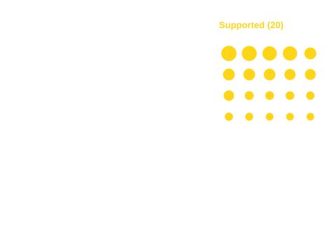

<!-- Homepage hero. Styles: theme-eu-refresh.scss; the draw: assets/hero/random-draw.js -->
:::::: {.hero .column-screen}
::::: {.hero-inner}
:::: {.hero-copy}
# Join a growing community of practice for experimental evaluation in Europe

This website pools knowledge and resources to help managing authorities and evaluators use randomised controlled trials (RCTs) to learn what works in cohesion policy interventions.

::: {.hero-actions}
[Why and when to use an RCT](01-why-and-when.qmd){.hero-btn .primary} [See examples](03-examples.qmd){.hero-btn}
:::
::::

```{=html}
<div class="hero-draw" role="figure" aria-labelledby="hero-draw-caption">
  
  <div class="hero-draw-caption"><span id="hero-draw-caption">A random draw splits eligible applicants into two groups with a similar mix of firms. Any difference that appears later can be credited to the intervention.</span><button type="button" class="draw-again" hidden>Run the draw again</button></div>
  <span class="visually-hidden" aria-live="polite"></span>
</div>
<script src="assets/hero/random-draw.js" defer></script>
```
:::::
::::::

::: {.team-note}
## Summary {.unlisted}
This website offers the concepts, examples and practical resources needed to get started with RCTs, both for those considering one for the first time and for those who already have experience with experimentation.
This page explains what RCTs are, how they fit among other impact evaluation methods, which questions they can answer and why they matter for cohesion policy. It ends with a guide to the rest of the site.
:::

## What is an RCT?
Experimentation, or experimental evaluation, means testing an intervention by assigning eligible participants at random either to receive it (or one version of it) or to a comparison group (also called a control group) that does not receive it, or receives a different version. This is called a randomised controlled trial (RCT). On this website, the terms "experimentation" and "RCT" are used interchangeably.

Randomisation can be used, for example, when there are more eligible applicants than available places, or when an intervention is rolled out in phases and the order in which participants receive it is decided at random. Comparing average outcomes between the groups shows whether the intervention – and not something else going on at the same time – is the reason for the observed changes.

Who ends up in which group is decided by a random draw. It is not decided by who applied first, who looked most promising or whom the reviewer favoured. Because assignment is random, the groups are similar on average before the intervention starts, and any remaining differences between them are due only to chance. That is true not just for characteristics that can be measured, but also for those that cannot be observed. So when a difference between the groups shows up later, it can be attributed to the intervention, provided the trial is implemented as planned and outcomes are measured in the same way for both groups.

```{=html}
<figure class="fig-e">
<svg class="fig-wide" viewBox="0 0 660 262" xmlns="http://www.w3.org/2000/svg" font-family="Arial, sans-serif" role="img" aria-label="Eligible applicants with a mix of characteristics are split by a random draw into an intervention group and a comparison group with a similar mix on average. Later, the difference between the two groups' average outcomes is the effect of the intervention.">
  <!-- column headers -->
  <rect x="10" y="14" width="150" height="34" rx="5" fill="var(--dg-ink)"/>
  <text x="85" y="36" text-anchor="middle" fill="var(--dg-reverse)" font-size="13.5" font-weight="bold">Eligible applicants</text>
  <rect x="215" y="14" width="180" height="34" rx="5" fill="var(--dg-ink)"/>
  <text x="305" y="36" text-anchor="middle" fill="var(--dg-reverse)" font-size="13.5" font-weight="bold">Random draw</text>
  <rect x="435" y="14" width="215" height="34" rx="5" fill="var(--dg-ink)"/>
  <text x="542" y="36" text-anchor="middle" fill="var(--dg-reverse)" font-size="13.5" font-weight="bold">Outcomes</text>

  <!-- pool: 16 applicants, 6 small, 6 medium, 4 large -->
  <rect x="10" y="64" width="150" height="184" rx="5" fill="var(--dg-panel)" stroke="var(--dg-rule)"/>
  <g fill="var(--dg-rule)" stroke="var(--dg-line)" stroke-width="1.5">
    <circle cx="40" cy="98" r="9"/><circle cx="70" cy="98" r="4.5"/><circle cx="100" cy="98" r="6.5"/><circle cx="130" cy="98" r="4.5"/>
    <circle cx="40" cy="132" r="6.5"/><circle cx="70" cy="132" r="9"/><circle cx="100" cy="132" r="4.5"/><circle cx="130" cy="132" r="6.5"/>
    <circle cx="40" cy="166" r="4.5"/><circle cx="70" cy="166" r="6.5"/><circle cx="100" cy="166" r="9"/><circle cx="130" cy="166" r="4.5"/>
    <circle cx="40" cy="200" r="6.5"/><circle cx="70" cy="200" r="4.5"/><circle cx="100" cy="200" r="6.5"/><circle cx="130" cy="200" r="9"/>
  </g>
  <text x="85" y="236" text-anchor="middle" fill="var(--dg-ink-soft)" font-size="11">a mix of applicants</text>

  <!-- the draw splits the pool -->
  <path d="M160 156 H188 V103 H209 M188 156 V209 H209" stroke="var(--dg-line)" stroke-width="1.5" fill="none"/>
  <path d="M215 103 L207 99 V107 Z M215 209 L207 205 V213 Z" fill="var(--dg-line)"/>

  <!-- intervention group: 3 small, 3 medium, 2 large -->
  <rect x="215" y="64" width="180" height="78" rx="5" fill="var(--dg-panel)" stroke="var(--dg-rule)"/>
  <text x="305" y="84" text-anchor="middle" fill="var(--dg-ink)" font-size="12.5" font-weight="bold">Intervention group</text>
  <g fill="var(--dg-accent)" stroke="var(--dg-ink)" stroke-width="1.2">
    <circle cx="235" cy="108" r="6.5"/><circle cx="255" cy="108" r="4.5"/><circle cx="275" cy="108" r="9"/><circle cx="295" cy="108" r="4.5"/>
    <circle cx="315" cy="108" r="6.5"/><circle cx="335" cy="108" r="9"/><circle cx="355" cy="108" r="4.5"/><circle cx="375" cy="108" r="6.5"/>
  </g>
  <text x="305" y="133" text-anchor="middle" fill="var(--dg-ink-soft)" font-size="11">receives the intervention</text>

  <text x="305" y="160" text-anchor="middle" fill="var(--dg-ink-soft)" font-size="11" font-style="italic">&#8776; similar mix on average</text>

  <!-- comparison group: 3 small, 3 medium, 2 large -->
  <rect x="215" y="170" width="180" height="78" rx="5" fill="var(--dg-panel)" stroke="var(--dg-rule)"/>
  <text x="305" y="190" text-anchor="middle" fill="var(--dg-ink)" font-size="12.5" font-weight="bold">Comparison group</text>
  <g fill="var(--dg-panel)" stroke="var(--dg-ink)" stroke-width="1.5">
    <circle cx="235" cy="214" r="4.5"/><circle cx="255" cy="214" r="6.5"/><circle cx="275" cy="214" r="6.5"/><circle cx="295" cy="214" r="9"/>
    <circle cx="315" cy="214" r="4.5"/><circle cx="335" cy="214" r="9"/><circle cx="355" cy="214" r="6.5"/><circle cx="375" cy="214" r="4.5"/>
  </g>
  <text x="305" y="239" text-anchor="middle" fill="var(--dg-ink-soft)" font-size="11">does not receive it</text>

  <!-- both groups are followed over time -->
  <path d="M395 103 H415 V156 H429 M395 209 H415 V156" stroke="var(--dg-line)" stroke-width="1.5" fill="none"/>
  <path d="M435 156 L427 152 V160 Z" fill="var(--dg-line)"/>

  <!-- outcomes -->
  <rect x="435" y="64" width="215" height="184" rx="5" fill="var(--dg-panel)" stroke="var(--dg-rule)"/>
  <text x="542" y="86" text-anchor="middle" fill="var(--dg-ink)" font-size="12.5" font-weight="bold">Average outcome</text>
  <rect x="455" y="112" width="34" height="110" fill="var(--dg-accent)" stroke="var(--dg-ink)" stroke-width="1.2"/>
  <rect x="518" y="152" width="34" height="70" fill="var(--dg-panel)" stroke="var(--dg-ink)" stroke-width="1.5"/>
  <path d="M447 222 H640" stroke="var(--dg-line)" stroke-width="1.5"/>
  <text x="472" y="238" text-anchor="middle" fill="var(--dg-ink-soft)" font-size="10.5">Intervention</text>
  <text x="535" y="238" text-anchor="middle" fill="var(--dg-ink-soft)" font-size="10.5">Comparison</text>
  <path d="M489 112 H565 M552 152 H565" stroke="var(--dg-line)" stroke-width="1" stroke-dasharray="3 3"/>
  <path d="M565 112 V152 M561 112 H569 M561 152 H569" stroke="var(--dg-ink)" stroke-width="1.5" fill="none"/>
  <text x="574" y="129" fill="var(--dg-ink)" font-size="11.5" font-weight="bold">Effect of the</text>
  <text x="574" y="143" fill="var(--dg-ink)" font-size="11.5" font-weight="bold">intervention</text>
</svg>
<svg class="fig-phone" viewBox="0 0 360 578" xmlns="http://www.w3.org/2000/svg" font-family="Arial, sans-serif" role="img" aria-label="Eligible applicants with a mix of characteristics are split by a random draw into an intervention group and a comparison group with a similar mix on average. Later, the difference between the two groups' average outcomes is the effect of the intervention.">
  <rect x="10" y="10" width="340" height="34" rx="5" fill="var(--dg-ink)"/>
  <text x="180" y="32" text-anchor="middle" fill="var(--dg-reverse)" font-size="14" font-weight="bold">Eligible applicants</text>
  <rect x="10" y="54" width="340" height="96" rx="5" fill="var(--dg-panel)" stroke="var(--dg-rule)"/>
  <g fill="var(--dg-rule)" stroke="var(--dg-line)" stroke-width="1.5">
    <circle cx="54" cy="80" r="9"/><circle cx="90" cy="80" r="4.5"/><circle cx="126" cy="80" r="6.5"/><circle cx="162" cy="80" r="4.5"/>
    <circle cx="198" cy="80" r="6.5"/><circle cx="234" cy="80" r="9"/><circle cx="270" cy="80" r="4.5"/><circle cx="306" cy="80" r="6.5"/>
    <circle cx="54" cy="112" r="4.5"/><circle cx="90" cy="112" r="6.5"/><circle cx="126" cy="112" r="9"/><circle cx="162" cy="112" r="4.5"/>
    <circle cx="198" cy="112" r="6.5"/><circle cx="234" cy="112" r="4.5"/><circle cx="270" cy="112" r="6.5"/><circle cx="306" cy="112" r="9"/>
  </g>
  <text x="180" y="140" text-anchor="middle" fill="var(--dg-ink-soft)" font-size="11.5">a mix of applicants</text>
  <path d="M180 150 V160" stroke="var(--dg-line)" stroke-width="1.5"/>
  <path d="M180 166 L176 158 H184 Z" fill="var(--dg-line)"/>

  <rect x="10" y="166" width="340" height="34" rx="5" fill="var(--dg-ink)"/>
  <text x="180" y="188" text-anchor="middle" fill="var(--dg-reverse)" font-size="14" font-weight="bold">Random draw</text>
  <path d="M180 200 V208 H92 V214 M180 208 H268 V214" stroke="var(--dg-line)" stroke-width="1.5" fill="none"/>

  <rect x="10" y="214" width="165" height="112" rx="5" fill="var(--dg-panel)" stroke="var(--dg-rule)"/>
  <text x="92" y="234" text-anchor="middle" fill="var(--dg-ink)" font-size="12.5" font-weight="bold">Intervention group</text>
  <g fill="var(--dg-accent)" stroke="var(--dg-ink)" stroke-width="1.2">
    <circle cx="53" cy="260" r="6.5"/><circle cx="79" cy="260" r="4.5"/><circle cx="105" cy="260" r="9"/><circle cx="131" cy="260" r="4.5"/>
    <circle cx="53" cy="288" r="6.5"/><circle cx="79" cy="288" r="9"/><circle cx="105" cy="288" r="4.5"/><circle cx="131" cy="288" r="6.5"/>
  </g>
  <text x="92" y="316" text-anchor="middle" fill="var(--dg-ink-soft)" font-size="11">receives the intervention</text>

  <rect x="185" y="214" width="165" height="112" rx="5" fill="var(--dg-panel)" stroke="var(--dg-rule)"/>
  <text x="267" y="234" text-anchor="middle" fill="var(--dg-ink)" font-size="12.5" font-weight="bold">Comparison group</text>
  <g fill="var(--dg-panel)" stroke="var(--dg-ink)" stroke-width="1.5">
    <circle cx="228" cy="260" r="4.5"/><circle cx="254" cy="260" r="6.5"/><circle cx="280" cy="260" r="6.5"/><circle cx="306" cy="260" r="9"/>
    <circle cx="228" cy="288" r="4.5"/><circle cx="254" cy="288" r="9"/><circle cx="280" cy="288" r="6.5"/><circle cx="306" cy="288" r="4.5"/>
  </g>
  <text x="267" y="316" text-anchor="middle" fill="var(--dg-ink-soft)" font-size="11">does not receive it</text>

  <text x="180" y="346" text-anchor="middle" fill="var(--dg-ink-soft)" font-size="11.5" font-style="italic">&#8776; similar mix on average</text>
  <path d="M180 354 V364" stroke="var(--dg-line)" stroke-width="1.5"/>
  <path d="M180 370 L176 362 H184 Z" fill="var(--dg-line)"/>

  <rect x="10" y="370" width="340" height="34" rx="5" fill="var(--dg-ink)"/>
  <text x="180" y="392" text-anchor="middle" fill="var(--dg-reverse)" font-size="14" font-weight="bold">Outcomes</text>
  <rect x="10" y="414" width="340" height="156" rx="5" fill="var(--dg-panel)" stroke="var(--dg-rule)"/>
  <text x="180" y="436" text-anchor="middle" fill="var(--dg-ink)" font-size="12.5" font-weight="bold">Average outcome</text>
  <rect x="80" y="456" width="44" height="88" fill="var(--dg-accent)" stroke="var(--dg-ink)" stroke-width="1.2"/>
  <rect x="160" y="500" width="44" height="44" fill="var(--dg-panel)" stroke="var(--dg-ink)" stroke-width="1.5"/>
  <path d="M30 544 H330" stroke="var(--dg-line)" stroke-width="1.5"/>
  <text x="102" y="560" text-anchor="middle" fill="var(--dg-ink-soft)" font-size="11">Intervention</text>
  <text x="182" y="560" text-anchor="middle" fill="var(--dg-ink-soft)" font-size="11">Comparison</text>
  <path d="M124 456 H226 M204 500 H226" stroke="var(--dg-line)" stroke-width="1" stroke-dasharray="3 3"/>
  <path d="M226 456 V500 M222 456 H230 M222 500 H230" stroke="var(--dg-ink)" stroke-width="1.5" fill="none"/>
  <text x="238" y="474" fill="var(--dg-ink)" font-size="12" font-weight="bold">Effect of the</text>
  <text x="238" y="489" fill="var(--dg-ink)" font-size="12" font-weight="bold">intervention</text>
</svg>
<figcaption>Note: dot sizes stand for applicants with different characteristics. Because the draw is random, both groups end up with a similar mix on average, so a later difference in their average outcomes can be attributed to the intervention. The comparison group can also receive a different version of the intervention. Bar heights are illustrative.</figcaption>
</figure>
```

## What is impact evaluation – and where do RCTs fit in?

::: {.gold-panel}
Impact evaluation answers the question: what causal effect did this intervention have
on outcomes such as employment, skills or firm growth – for whom did it work
best, and under which conditions?
:::

An impact evaluation compares what happened after an intervention was introduced with what
would have happened in its absence: the counterfactual. Unlike monitoring, which tracks whether an intervention is implemented as planned, it tests
whether the intervention caused a real difference. It is one of several types of evaluation, alongside implementation evaluation, that managing authorities can include in their evaluation plans. 

There is more than one credible way to conduct an impact evaluation, and the right choice depends on the intervention, the available data and the timing.
Quasi-experimental methods, such as matching,
difference-in-differences or regression discontinuity design, compare participants with similar
non-participants. Because the evaluator does not decide who ends up in which group, the comparability of the groups rests on assumptions that need to be stated and discussed.

In an RCT, the comparison group is created by random assignment before the intervention starts, so the comparability of the groups does not depend on such assumptions. The Commission's [Better Regulation toolbox](https://commission.europa.eu/law/law-making-process/better-regulation/better-regulation-guidelines-and-toolbox/better-regulation-toolbox_en) (Tool #68) describes randomised controlled trials as "the benchmark for scientific quantitative methods", with quasi-experimental methods as the option when randomised trials are not possible. As an RCT requires random assignment to the intervention, it has to be planned before or during implementation. See more on [how RCTs differ from quasi-experimental methods](01-why-and-when.qmd#alternatives) and [when an RCT is the right choice](01-why-and-when.qmd#two-questions) on the [RCTs: why and when](01-why-and-when.qmd) page.

## What questions can an RCT answer?

An RCT can answer several kinds of questions, depending on how it is designed:

::: {.cards}
::: {.card-e}
### How effective is a given intervention? {.unlisted}
Whether the intervention works, and for whom it works best.
:::
::: {.card-e}
### Which version of an intervention is most effective? {.unlisted}
How different versions of an intervention compare – which parts of an intervention work, which do not and
how they work together.
:::
::: {.card-e}
### How should an intervention be delivered? {.unlisted}
How different delivery mechanisms change results, including how to target beneficiaries
accurately and increase take-up.
:::
::: {.card-e}
### Is it worth the cost? {.unlisted}
How cost-effective the intervention is, and how it compares to other interventions.
:::
:::
The question one wants answered decides when, how and for whom the RCT has to be planned. To find out whether
an intervention works at all, randomisation must be built in before launch, from the call for
proposals. To find out which version works better (a grant alone versus a grant plus
advisory support, for instance), an RCT can still be added after the intervention has started.
Randomisation then shifts from who gets funded at all to which version each participant
receives. See [Choosing the right evaluation design](01-why-and-when.qmd#choosing-design) on the [RCTs: why and when](01-why-and-when.qmd) page.

## Why experiment in cohesion policy?

Cohesion policy supports all EU regions, investing in areas ranging from innovation and the green transition to transport, social inclusion and local development. To design and adjust these interventions well, managing authorities need robust evidence on what they achieve, for whom and under which conditions.

Experimentation is one way to obtain such evidence. Because an RCT creates the comparison group by random assignment, it provides robust causal evidence on whether an intervention made a difference.

Experimentation also supports evidence-based policymaking and adaptive learning. Testing different versions of an intervention, or rolling it out in phases, lets managing authorities learn while delivery is under way and adjust the design, targeting or delivery of later rounds. Findings from one region can inform similar interventions in other regions and in future programming periods.

::: {.gold-panel}
Experimentation allows for testing, learning and adjusting during delivery.
:::


### Hear from European Commission representatives on why experimentation matters
::: {.video-frame}

:::


### Hear from managing authorities who already use experimentation

::: {.video-frame}

:::


***
## How to start {.band}

### Explore the site

:::: {.cards}
::: {.card-e}
#### [RCTs: why and when](01-why-and-when.qmd)
What RCTs can and cannot show, how they compare with other evaluation methods, when to use and plan one, and common questions about RCTs.
:::
::: {.card-e}
#### [How to design an RCT](02-how.qmd)
How to plan an RCT in eight steps: from the causal logic of the intervention, through choosing the right design, to ensuring high-quality data is collected.
:::
::: {.card-e}
#### [Examples](03-examples.qmd)
Experiences from projects partnering with the EuroCOMP Lab and beyond.
:::
::: {.card-e}
#### [Repository](04-templates.qmd)
Outcome indicators and survey questions, organised by topic.
:::
::::

### Connect with researchers and labs specialised in experimentation

:::: {.cards}
::: {.card-e}
#### [EuroCOMP Lab](eurocomp.qmd)
The joint DG REGIO and World Bank initiative behind this site.
:::
::: {.card-e}
#### [Other partners](research-partners.qmd)
Established labs already supporting experimentation.
:::
::::

### The EU needs more managing authorities leading the change towards experimentation in policymaking {.unlisted}


::: {.video-frame}

:::
